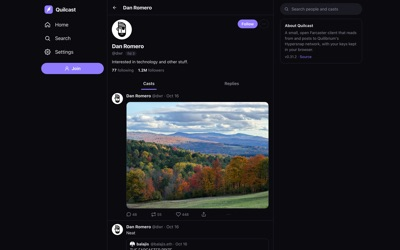

# Hypersnap Clients and Apps

This is a list of hypersnap-compatible clients and applications.

**Note that this list does not vouch for the security of any project: due diligence projects and developers yourself before trusting any with your keys!** ☝️😺

## Index

- [Clients](#clients)
  - [GenyCaster](#genycaster)
  - [Linkcast](#linkcast)
  - [meowdy](#meowdy)
  - [Opencaster](#opencaster)
  - [Quilcast](#quilcast)
  - [Quorum](#quorum)
  - [Terminus](#terminus)
  - [Vibeshift](#vibeshift)
- [Applications](#applications)
  - [Forkcaster 🍴](#forkcaster-)
- [Other Neat Stuff](#other-neat-stuff)
- [Add Your Project](#add-your-project)

## Clients

### GenyCaster

<a href="https://github.com/user-attachments/assets/359f9f22-971d-4b10-9778-91266195e88f" target="_blank">
  
</a>

- Description: GenyCaster is a high-performance, local-first Farcaster client with a cross-platform, multi-node architecture built for the next generation of social experiences.
- Developer: [GenyLeap](https://genyleap.com)
- Link(s): [website](https://genycaster.xyz)
- Pure hypersnap? ✅ (By default, with support for multiple nodes and protocols.)

### Linkcast
- Description: Discover links on Farcaster.
- Developer: [ghostlinkz.eth](https://warpcats.com/ghostlinkz.eth)
- Link(s): [website](https://linkcast.xyz) | [social](https://warpcats.com/linkcast)
- Pure hypersnap? ✅ (All Farcaster data: casts, profiles, follows, reactions, threads and the webhook, comes from one Hypersnap node - haatz.quilibrium.com.)

### meowdy

<a href="https://qstorage.quilibrium.com/arfonzo/meowdy_screensho_-_hypersnap_purist.png" target="_blank">
  
</a>

- Description: a CLI and TUI hypersnap client for terminals, scripting, agents and more.
- Status: unreleased
- Developer: [arfonzo](https://warpcats.com/arfonzo)
- Link(s): [demo video](https://x.com/arfonzo/status/2112353529180365281)
- Pure hypersnap? ✅

### Opencaster
- Description: An independent browser client forked from Quorum Desktop, with public browsing and browser-held device signing keys. Client and gateway code are AGPL-3.0; the optional WalletConnect SDK uses a non-OSI Community License.
- Developer: [Arca Computer](https://arca.computer)
- Link(s): [website](https://opencaster.org) | [source and self-hosting](https://github.com/arcacomputer/opencaster/tree/main/hypersnap)
- Pure hypersnap? ✅ (Social reads/writes and signer authorization use Hypersnap, not Neynar or Farcaster-hosted APIs/login. Opencaster uses its own access-restricted Hypersnap node as primary, with `haatz.quilibrium.com` as fallback. The hosted gateway and media use Cloudflare; optional WalletConnect uses Reown's relay.)

### Quilcast

<a href="images/quilcast.jpg" target="_blank">
  
</a>

- Description: a fast, open-source Farcaster web client that talks to Hypersnap straight from the browser. Feeds, threads, notifications, posting, permissionless signup, multiple accounts, mini apps and MySpace-style profile looks.
- Developer: [borodutch](https://quilcast.com/u/borodutch)
- Link(s): [website](https://quilcast.com) | [source](https://github.com/backmeupplz/quilcast) | [social](https://quilcast.com/u/quilcast)
- Pure hypersnap? no (every read and post goes to a Hypersnap node, haatz.quilibrium.com. Outside Hypersnap: signup registers the FID on Optimism and claims an fname from Farcaster's fname server, image/video uploads go to Farcaster's CDN, and Messages use farcaster.xyz direct casts.)

### Quorum
- Description: official client from quilibrium. Privacy-focused application and website.
- Developer: [Quilibrium](https://github.com/QuilibriumNetwork/)
- Link(s): [website](https://www.quorummessenger.com/)
- Pure hypersnap? ✅

### Terminus
- Description: A lightweight, native iOS client for Hypersnap. Feeds, threads, channels, notifications and posting, with your keys kept on your iPhone.
- Developer: [kyb](https://warpcats.com/kyb)
- Link(s): [TestFlight](https://testflight.apple.com/join/cSPBnkud)
- Pure hypersnap? ✅ (Every read and post goes to Hypersnap nodes, and sign-in adds a Hypersnap-only signer. Two read-only lookups go to Farcaster's public API through Terminus's proxy: the channel directory (names and images) and accounts' opt-in status.)

### Vibeshift
- Description: An installable Farcaster web client with customizable feeds for friends, channels, starter packs, and signer apps. Includes signer-app labels and filters, Network School vote/burn badges, Farcaster Stats integration, bulk follow/unfollow tools, threaded conversations, miniapps, tipping, notifications, and themes. Bring your own QStorage or Pinata credentials for image uploads.
- Developer: [mvr](https://vibeshift.onchain.cooking/p/mvr)
- Link(s): [website](https://vibeshift.onchain.cooking) | [social](https://warpcats.com/vibeshift)
- Pure hypersnap? ✅ (Core social reads and writes use our own Hypersnap node through an indexed backend. Some metadata and authentication flows still use Farcaster services; wallets, storage, and tipping are separate integrations.)

## Applications

### Forkcaster 🍴

<a href="https://forkcaster.xyz/landing-dark.png" target="_blank">
  
</a>

- Description: drop-in replacement for any farcaster or warpcast URL, letting users decide which client to use
- Developer: [decent-artlu](https://forkcaster.xyz/decent-artlu)
- Link(s): [forkcaster](https://forkcaster.xyz), [warpcats](https://warpcats.com), [/transparency](https://forkcaster.xyz/transparency)
- Pure hypersnap? **no**, attempts to simulate flagship Farcaster experience

## Other Neat Stuff

## Add Your Project
If you'd like your project to be added, please get in touch or submit a PR for review. Follow the alphabetical sort. 3 links maximum.

Template example, with screenshot:
```
### Project Name

<a href="https://link.to/image.jpg" target="_blank">
  
</a>

- Description: a short description.
- Developer: [dev_name](https://warpcats.com/arfonzo)
- Link(s): [website](https://www.quorummessenger.com/)
- Pure hypersnap? ✅/no (and add details if you want)
```

Template example, no screenshot:
```
### Project Name
- Description: a short description.
- Developer: [dev_name](https://warpcats.com/arfonzo)
- Link(s): [website](https://www.quorummessenger.com/)
- Pure hypersnap? ✅/no (and add details if you want)
```

- **Screenshot:** feel free to include one screenshot, max width 400 pixels. If not, remove the entire `<a>` block from your submission.
- **Pure hypersnap?** relevant for clients and apps to show where the featureset uses hypersnap in lieu of snapchain nodes/neynar API/farcaster API: read/write operations (casts, profile, account management), communications, etc.. For example, if your client uses farcaster's API for certain features like direct messages, it should be detailed here for clarity.
